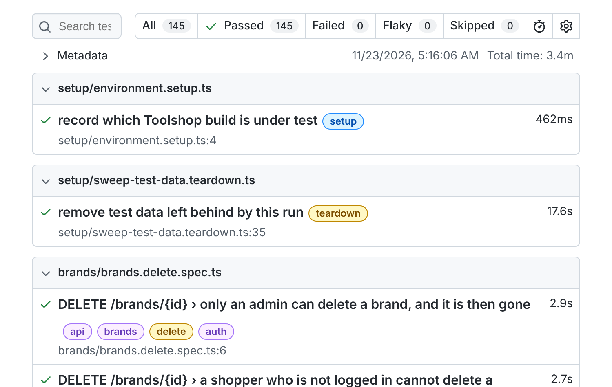
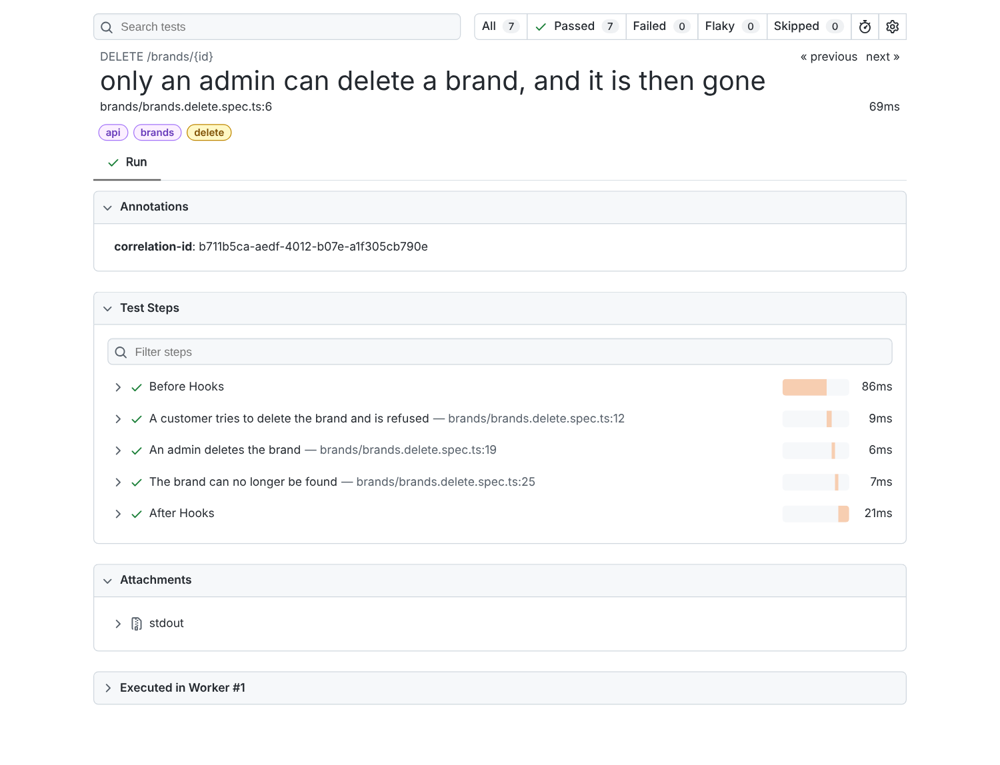
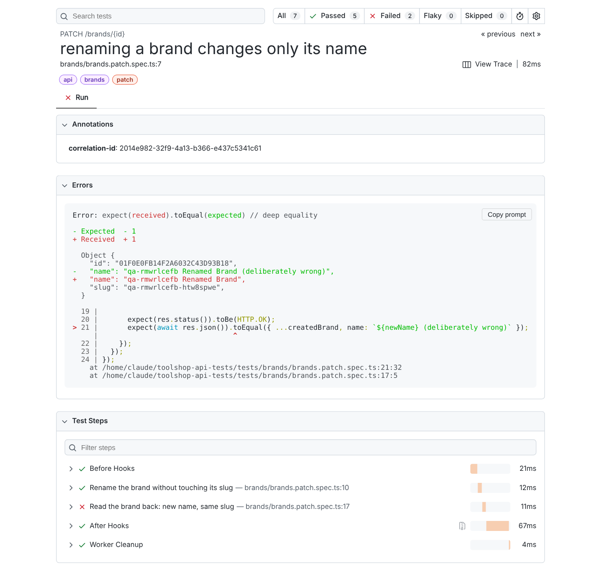
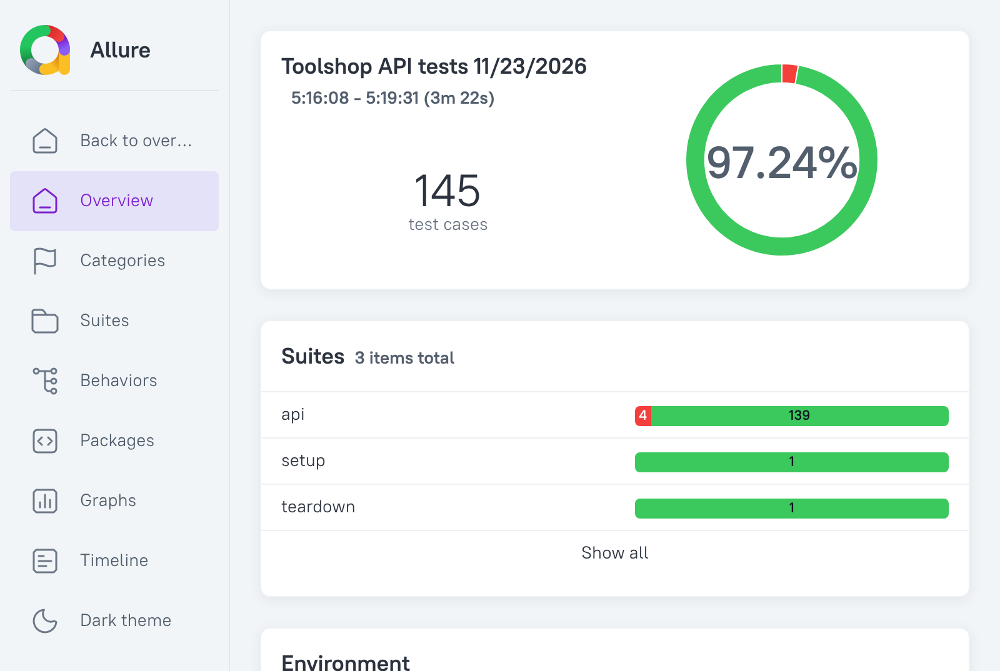
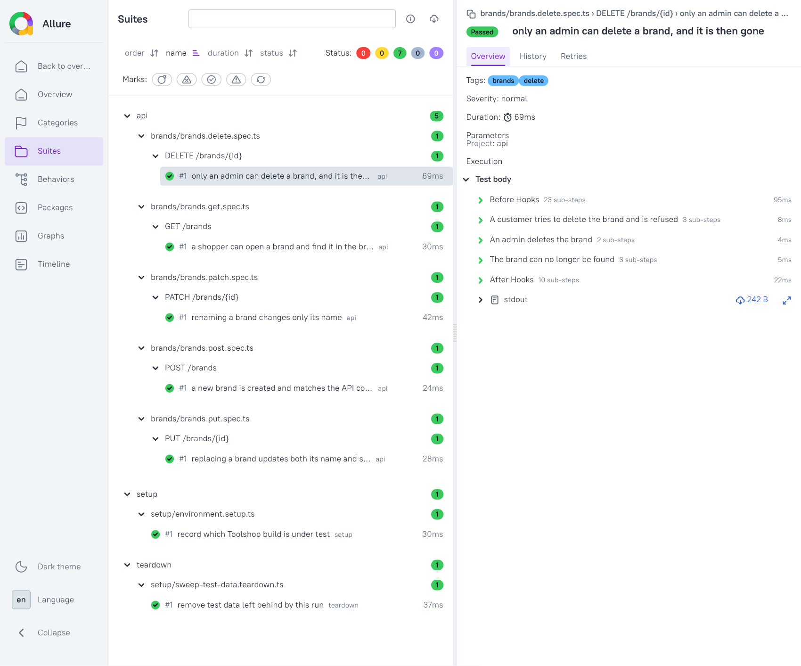

# toolshop-api-tests

API test automation for the [Toolshop API](https://api.practicesoftwaretesting.com/api/documentation)
by Practice Software Testing, built with Playwright and TypeScript.

## What it does

Tests the `/brands` endpoints with one test per HTTP method: GET, POST, PUT, PATCH and DELETE.
Each test checks status codes, the response contract and the business rule, creates its own data and cleans it up.

## Features

- **Fixture-based framework**: specs ask for what they need (`brandsClient`, `createdBrand`, `adminApi`) and
  Playwright fixtures handle login, test data and cleanup.
- **Readable reports**: every test is written as business-language `test.step`s, tagged by resource and method.
- **Contract checks**: responses are validated with zod schemas.
- **Safe on a shared API**: each run registers its own customer, tags all its data with a run id and sweeps up anything left behind.
- **Failure evidence**: one correlation id per test, plus a full API call log (`api-calls.json`) and a trace when a test fails.
- **Offline mode**: a built-in stub runs the whole suite with no network or credentials.
- **Strict code quality**: type-aware ESLint with Playwright rules, Prettier, and pre-commit hooks.
- **CI ready**: GitHub Actions and Jenkins, with JUnit, HTML and Allure reports.
- **AI-agent ready**: shared instructions, skills, agents and prompts for Claude Code and GitHub Copilot (see [AGENTS.md](AGENTS.md)).

## Reports

**HTML report**: tests grouped by endpoint, with tags for filtering.



**Test steps**: each test reads as a short list of business steps.



**Failure details**: the failing step, a clear diff, the correlation id and the attached API call log.
_The test in this screenshot was broken on purpose to show the output._



**Allure dashboard**: pass rate, suites, environment and the status trend across runs.



**Allure results table**: every test grouped by project, file and endpoint, with status and duration,
and the selected test's steps on the right.



## Requirements

- Node.js 24 (see `.nvmrc`)
- The password of the public Toolshop demo admin (published in the
  [practice-software-testing](https://github.com/testsmith-io/practice-software-testing) repository)

No browsers are needed.

## Setup

```bash
git clone https://github.com/youvegotnigel/toolshop-api-tests.git
cd toolshop-api-tests
npm ci
cp .env.example .env.local
```

Then set `ADMIN_PASSWORD` in `.env.local`. This file is git-ignored.

## Run

| Command                                        | What it runs                                            |
| ---------------------------------------------- | ------------------------------------------------------- |
| `npm test`                                     | All tests against the public API                        |
| `npm run test:stub`                            | All tests against the offline stub, no setup            |
| `npm run test:smoke`                           | Tests tagged `@smoke`                                   |
| `npx playwright test --grep @delete`           | Tests for one method or tag                             |
| `npm run verify`                               | Typecheck, lint, format check and all tests             |
| `npm run report`                               | Opens the last HTML report                              |
| `npm run test:allure && npm run allure:report` | Runs tests and opens the Allure report (`allurerc.yml`) |

## CI

- **GitHub Actions** (`.github/workflows/ci.yml`): add the repository secret `TOOLSHOP_ADMIN_PASSWORD`.
  Without it, CI runs against the offline stub and shows a warning.
- **Jenkins** (`Jenkinsfile`): add a Secret text credential `toolshop-admin-password`.
  Requires the Docker Pipeline, JUnit and HTML Publisher plugins.

## Project structure

```
src/clients     API clients, one per resource
src/fixtures    Playwright fixtures: auth, clients, test data
src/schemas     Response contracts (zod)
src/data        Test data builders
tests/          Specs, plus setup and teardown
stub/           Offline stand-in for the Toolshop API
docs/images     Report screenshots
```

## Reference

- [Playwright API testing mind map](https://claude.ai/artifact/HV5QFHMyWAnocRhT5ddv9F): the fixture, request and
  best-practice reference this framework follows.

## Contributing

Coding rules, conventions and the AI agent setup are in [AGENTS.md](AGENTS.md).

## License

[MIT](LICENSE)
